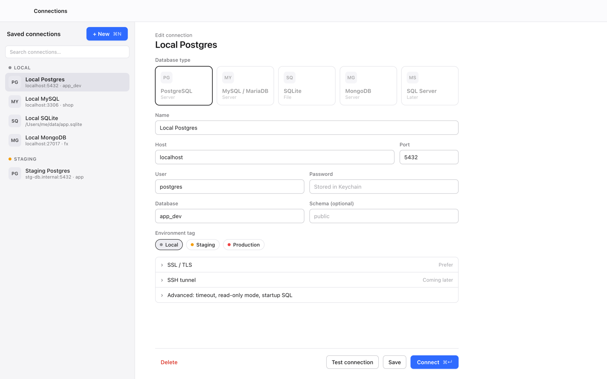
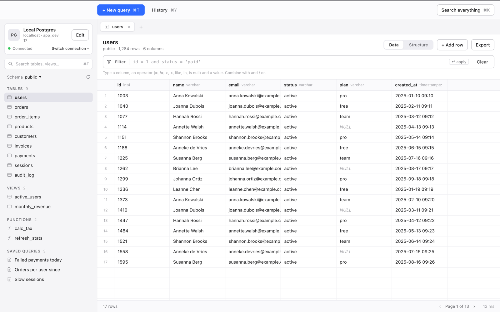
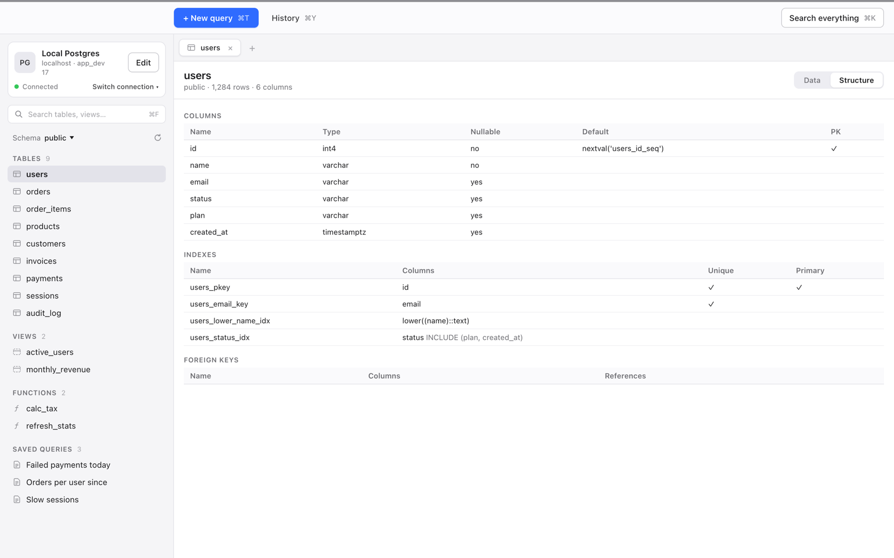
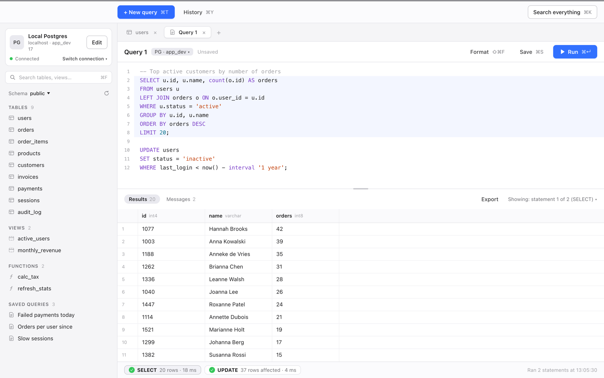

# Porthole

A fast Mac app for a quick look into your databases.

Porthole is for the everyday database jobs: browse the structure, view and edit data, run queries, and export the results. It is not an IDE: there is no schema designer and no migration tooling.









## Supported databases

|                         | PostgreSQL                     | MySQL / MariaDB                | SQLite                         | MongoDB                                 |
| ----------------------- | ------------------------------ | ------------------------------ | ------------------------------ | --------------------------------------- |
| Tested with             | 11 and 17                      | MySQL 8.4, MariaDB 11.4        | Bundled SQLite                 | 6.0 and 8.0                             |
| Browse                  | Tables, views                  | Tables, views                  | Tables, views                  | Collections, views                      |
| Functions, procedures   | Listed in the sidebar          | Listed in the sidebar          | Not applicable                 | Not applicable                          |
| Structure               | Columns, indexes, foreign keys | Columns, indexes, foreign keys | Columns, indexes, foreign keys | Sampled fields, indexes                 |
| Filter, sort, paging    | Yes                            | Yes                            | Yes                            | Yes                                     |
| Edit rows               | Yes                            | Yes                            | Yes                            | Yes                                     |
| Query tabs              | SQL                            | SQL                            | SQL                            | A subset of mongosh                     |
| Export CSV / JSON       | Yes                            | Yes                            | Yes                            | Yes                                     |

Notes:

- Editing needs a primary key (`_id` on MongoDB). Tables without one, and views, open read-only.
- Edits stay pending until you save, and **Show SQL** previews the statements first. Changes are saved in one transaction. A MongoDB server without transactions, such as a standalone server, applies them one at a time and tells you if it stops partway.
- MongoDB columns come from a sample of documents. A CSV export has only the sampled fields; a JSON export has the whole document.
- MongoDB query tabs take `db.collection.method(...)` calls such as `find`, `aggregate`, `insertOne`, `updateMany` and `deleteMany`. Porthole parses these calls itself; the tab is not a JavaScript shell.

## Features

- **Environment tags.** Tag a connection Local, Staging or Production. A Production connection asks for confirmation before it writes, both when you save edits and when you run a query that looks like it changes data.
- **Read-only mode.** A per-connection setting. MongoDB has no read-only sessions, so there Porthole blocks writes itself.
- **SSL/TLS.** From `disable` up to `verify-full` for server connections.
- **Saved queries with `:params`.** Write `where status = :status`, fill in the value, and save. The values are remembered.
- **History.** ⌘Y lists past runs, grouped by day. Click one to reopen it in a new tab.
- **Search everything.** ⌘K finds tables, saved queries, connections and actions.
- **Multiple windows.** ⇧⌘N opens another window, so you can work on several connections at once.

## Not yet

- SSH tunnel
- SQL Server
- Auto-update: to upgrade, download the new version and replace the app

## Install

1. Download the latest `Porthole_*_universal.dmg` from [Releases](https://github.com/mellowforge/porthole/releases/latest).
2. Open it and drag Porthole to Applications.

Porthole needs macOS 13.3 or later. The build is universal (Apple Silicon and Intel), signed and notarized.

## Where your data lives

Connection profiles, saved queries, query history and open tabs are stored in:

```
~/Library/Application Support/io.github.mellowforge.porthole/app.db
```

Passwords are stored in the macOS Keychain under the service `io.github.mellowforge.porthole`. They are never written to `app.db`.

## Building from source

See [CONTRIBUTING.md](CONTRIBUTING.md).

## License

[MIT](LICENSE)
